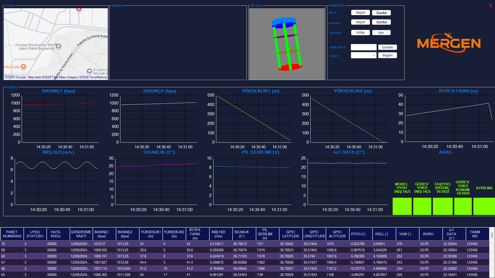

# Mergen-GCSS

Ground Control Station Software for a model satellite. It communicates over Wi-Fi with the Raspberry Pi on board the satellite: it receives telemetry over TCP and displays it in charts, a data table, a map and a 3D model. It also sends commands to the satellite and shows and records the satellite's camera stream.

Written in C# with Windows Forms (.NET Framework 4.7.2). The user interface is in Turkish.


*Main window. Values shown are sample data.*

## Features

- **Login and splash screens:** username and password login, followed by a splash screen.
- **Telemetry reception (TCP server):**
  - The server starts with the *Başlat* (Start) button in the Wi-Fi section; packets are read continuously once the satellite connects.
  - Each packet arrives in binary form: packet number and satellite status, error code, transmission time, 14 measurements, RHRH, IoT data and team number.
- **Charts:** 9 time charts for pressure 1–2, altitude 1–2, altitude difference, descent rate, temperature, battery voltage and IoT data.
- **Data table and logging:** every packet is added to the table (newest on top). The table is saved to `data.csv` on the desktop every 10 seconds.
- **Map:** the satellite's GPS position is shown with GMap.NET.
- **3D simulation:** the satellite model rotates with the received pitch / roll / yaw angles (OpenTK).
- **ARAS (fault detection) indicator:** five error-code bits; a faulty bit turns red with an audible alert.
- **Commands (to the satellite over TCP):**
  - **Separation:** the *Kilitle* (Lock) and *Ayır* (Release) buttons send the servo angle of the separation mechanism.
  - **Mechanical filtering:** the entered command is validated and sent.
- **Camera:** the MJPEG stream from the satellite's camera is displayed and recorded to the desktop as MP4.

## Files

| File | Contents |
|---|---|
| `mainForm.cs` | Main window, control buttons, map, ARAS |
| `TcpServer.cs` | Telemetry server, packet reading |
| `GondericiServer.cs` | Sending commands to the satellite |
| `DataGridViewHandler.cs` | Data table and CSV logging |
| `ChartHandler.cs` | Charts |
| `_3dSim.cs` | 3D satellite model |
| `Camera.cs` | MJPEG camera stream and recording |
| `loginForm.cs`, `splash.cs` | Login and splash screens |

## Build and run

**Requirements:**
- Windows 10 / 11
- Visual Studio 2019 or 2022 with the ".NET desktop development" workload (including .NET Framework 4.7.2)
- Internet connection for the map

**Steps:**
1. Clone the repository:
   ```
   git clone https://github.com/mergenmodeluydu/Mergen-GCSS.git
   ```
2. Open `Mergen GCSS.sln` in Visual Studio.
3. Restore NuGet packages: right-click the solution → *Restore NuGet Packages*.
4. Build and run (F5), then log in.
5. With the satellite and the ground station on the same network, press *Başlat* (Start) in the Wi-Fi section.

The server, command and camera IP addresses are defined in `mainForm.cs` and `Camera.cs`; change them to match your network.

## Libraries

GMap.NET (map), OpenTK (3D), AForge / Accord (camera and recording), System.Windows.Forms.DataVisualization (charts), MetroFramework and Guna.UI2 (interface).
